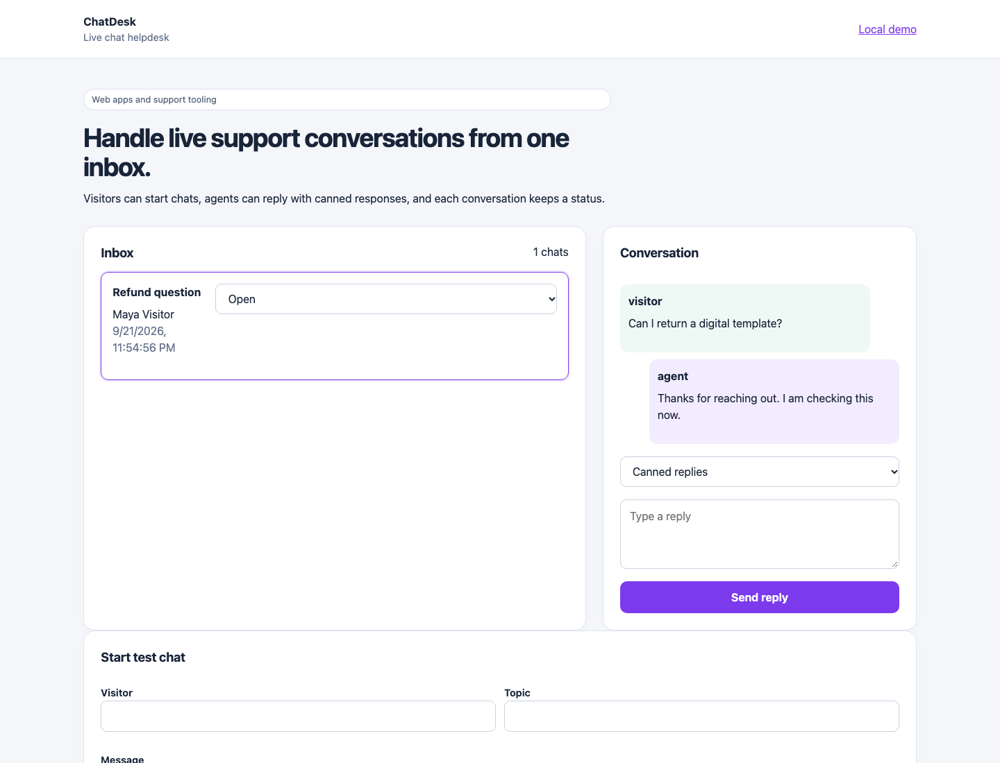

# ChatDesk



ChatDesk is a small live-chat helpdesk demo. It shows visitor conversations, agent replies, canned responses, and status tracking.

## Run

```sh
python3 server.py
```

Open `http://127.0.0.1:8106`.

## What it demonstrates

- Live chat style inbox UI
- SQLite conversations and messages
- Canned replies for support teams
- Status management
- Local HTTP and domain tests

This is a local portfolio demo. It does not include WebSockets, authentication, or real customer notifications.
